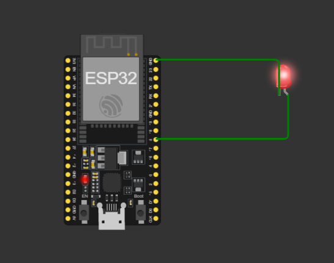

# 01 - Blink LED

Blink an LED connected to GPIO 2 every second.

## Simulation
[Open in Wokwi]((https://wokwi.com/projects/477465338550953985))

## Circuit

## Files
- `sketch.ino`: the code
- `diagram.json`: the circuit (copy into Wokwi to reproduce)

## What I learned
- GPIO pins and how setup()/loop() work
- A circuit must be closed: pin -> LED -> GND

## Problems I faced
- Avoided TX/RX pins (GPIO1/GPIO3) because they are used for Serial communication
- Pin numbers in code must match the physical wiring
