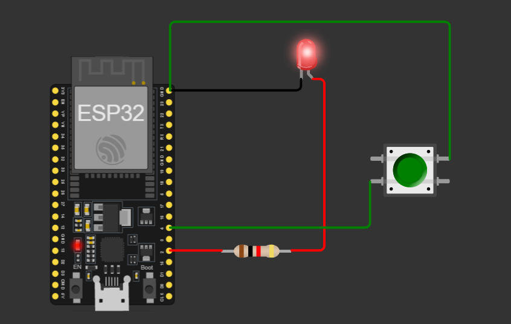

# 02 - Button + LED

Read a push button on GPIO 4 and turn an LED on GPIO 2 on while the button is pressed.

## Simulation
[Open in Wokwi](https://wokwi.com/projects/477499727219808257)

## Circuit

| Part | Pin | Mode |
|------|-----|------|
| LED (with 220 ohm resistor) | GPIO 2 | OUTPUT |
| Push button (other side to GND) | GPIO 4 | INPUT_PULLUP |

## Files
- `sketch.ino`: the code
- `diagram.json`: the circuit (copy into Wokwi to reproduce)

## How it works
`INPUT_PULLUP` enables an internal resistor that pulls the pin HIGH. Pressing the button connects the pin to GND, so the reading becomes LOW. The code checks for LOW and turns the LED on.

## What I learned
- Reading inputs with `digitalRead()` and making decisions with `if / else`
- Floating pins and why a pull-up resistor is needed
- `INPUT` vs `INPUT_PULLUP`: the internal pull-up removes the need for an external resistor
- Button logic is inverted: pressed = LOW, released = HIGH
- Why an LED needs a series resistor (current limiting)

## Problems I faced
- **Wrong wiring at first:** I connected the button in series with the LED (GPIO -> resistor -> button -> LED -> GND). The LED worked without the code reading anything. Fixed by making two separate circuits: LED on GPIO 2, button on GPIO 4.
- **Inverted readings:** had to remember that pressed = LOW.

## Challenges
- [x] Inverted behavior
- [ ] Toggle with debounce
- [x] INPUT vs INPUT_PULLUP experiment
