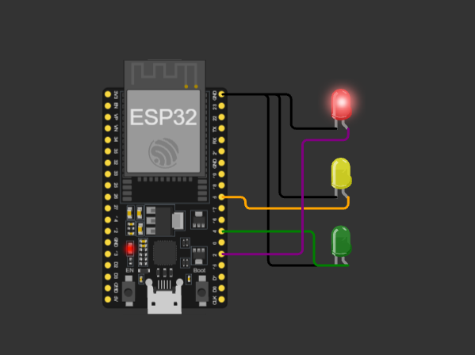

# 03 - Traffic Light

A traffic light with three LEDs (red, yellow, green) that cycles automatically using timed delays.

## Simulation
[Open in Wokwi](https://wokwi.com/projects/478737054386522113)

## Circuit

| Part | GPIO |
|------|------|
| Red LED | 2 |
| Yellow LED | 5 |
| Green LED | 4 |

Each LED's cathode (C) is connected to GND.

## Files
- `sketch.ino`: the code
- `diagram.json`: the circuit (copy into Wokwi to reproduce)

## How it works
The loop turns on one LED at a time, waits with `delay()`, turns it off, then moves to the next one.

| Light | Duration |
|-------|----------|
| Red | 5 s |
| Green | 5 s |
| Yellow | 2 s |

## What I learned
- Controlling several outputs from one program
- Only one LED is on at a time, so each one is turned off before the next turns on
- `delay()` blocks the whole board, so nothing else (like a button) can be read while waiting
- Slide switch vs. pushbutton: a switch stays in position, a button only conducts while pressed
- With `INPUT_PULLUP`, pressed (or connected to GND) = `LOW`

## Problems I faced
- The sequence order was wrong at first (red, green, yellow). A real traffic light goes green, yellow, red.
- I added a slide switch as a "button", but the code was reading it inverted (`HIGH` when not pressed), and `delay()` made it unresponsive for most of the cycle.

## Next steps
- [ ] Fix the sequence order: green, yellow, red
- [ ] Rewrite with `millis()` instead of `delay()`
- [ ] Add a pedestrian pushbutton using a state machine
