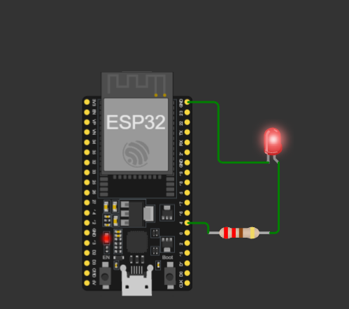

# 04 - PWM Fade (Breathing LED)

An LED on GPIO 4 that gradually gets brighter and dimmer using PWM, without `delay()`.

## Simulation
[Open in Wokwi](https://wokwi.com/projects/479427803920797697)

## Circuit

| Part | GPIO |
|------|------|
| LED (with resistor) | 4 |

LED cathode (C) to GND.

## Files
- `sketch.ino`: the code
- `diagram.json`: the circuit (copy into Wokwi to reproduce)

## How it works
PWM switches the pin on and off very fast. The fraction of time it is on (duty cycle) sets the perceived brightness. `analogWrite(pin, value)` takes 0 (off) to 255 (full).

Every 10 ms, `millis()` triggers one step: brightness changes by `step`, and at 0 or 255 the direction reverses. A full fade up takes about 2.55 s.

## What I learned
- PWM and duty cycle: 255 is a ratio (100%), not a voltage; the pin is always 3.3 V or 0 V
- `analogWrite` configured the pin by itself in my test, but I keep `pinMode` for clarity
- Non-blocking timing with `millis() - lastUpdate >= interval`
- One direction variable (`step = -step`) replaces many conditions

## Problems I faced
- Missing semicolons and `millis` without parentheses
- Subtracted in the wrong order (`last - current`)
- Mixed time (ms) with brightness (0 to 255) in one comparison
- Used `int` for time values (use `unsigned long`)
- No limits on brightness, so it could pass 0 and 255
