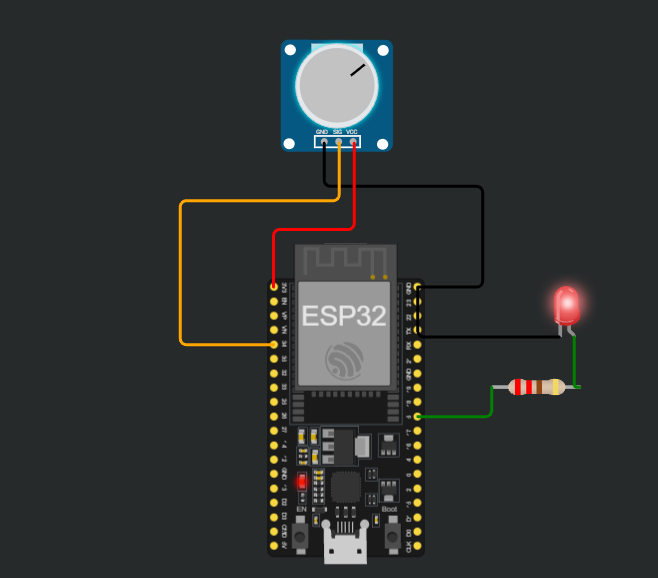

# 05 - ADC Dimmer

A potentiometer on GPIO 34 controls the brightness of an LED on GPIO 5.

## Simulation
[Open in Wokwi](https://wokwi.com/projects/479618843621190657)

## Circuit

| Part | GPIO |
|------|------|
| Potentiometer (SIG) | 34 (ADC1) |
| LED (with 220 ohm resistor) | 5 |

Potentiometer: GND to GND, VCC to 3V3. LED cathode to GND.

## Files
- `sketch.ino`: the code
- `diagram.json`: the circuit (copy into Wokwi to reproduce)

## How it works
`analogRead` converts the voltage (0 to 3.3 V) into 0 to 4095 (12-bit ADC). `map()` rescales it to 0 to 255, and `analogWrite` sends it as PWM to the LED.

Flow: potentiometer -> `analogRead` -> `map` -> `analogWrite` -> LED.

## What I learned
- ADC converts voltage to a number; PWM goes the other way
- ESP32 ADC is 12-bit (0 to 4095), unlike the Arduino Nano (0 to 1023)
- GPIO 34 is ADC1 and input-only; ADC2 pins conflict with WiFi
- `map()` converts between ranges (integers only, no clamping)
- The potentiometer is powered from 3.3 V, never 5 V
- Also tested on a real ESP32 Dev Module with Arduino IDE

## Problems I faced
- Wrong capitalization (`pinmode`, `analogwrite`) and missing semicolons
- Used 1023 (Nano range) instead of 4095
- Tried to power the potentiometer from a GPIO pin; it is just wired to 3V3
- "no upload port provided": I had selected the port but not the board (ESP32 Dev Module)
