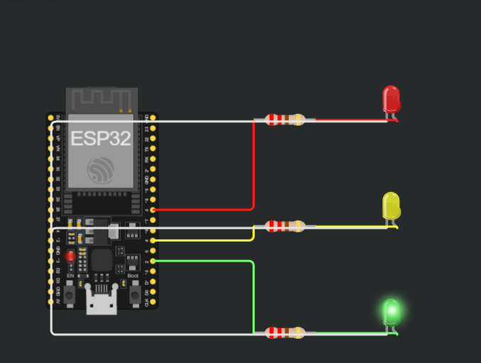

# 06 - Traffic Light v2

A traffic light using millis() and a state machine instead of delay(). Tested on a real ESP32 Dev Module.

## Simulation
[Open in Wokwi](https://wokwi.com/projects/480427524855796737)

## Circuit

| Part | GPIO |
|------|------|
| Green LED (with 220 ohm resistor) | 2 |
| Yellow LED (with 220 ohm resistor) | 4 |
| Red LED (with 220 ohm resistor) | 5 |

Each GPIO connects through a resistor to the LED anode. All LED cathodes connect to GND.

## Files
- `sketch.ino`: the code
- `diagram.json`: the circuit (copy into Wokwi to reproduce)

## How it works
`enum` defines three states: Green, Yellow, and Red. `Current_State` stores the active state, and `switch/case` runs its logic.

`millis() - TimeEll` calculates how long the current state has been active. When its duration ends, the code switches the LEDs, changes the state, and updates `TimeEll`.

Flow: Green (5 seconds) -> Yellow (2 seconds) -> Red (5 seconds) -> repeat.

Only one external LED is on at a time. No delay() is used, so loop() keeps running between transitions.

## What I learned
- `enum` gives names to the possible states
- `switch/case` selects code based on the current state
- `break` exits the switch
- Changing the state variable does not change the LEDs automatically
- `millis()` allows timing without pausing the loop
- `unsigned long` stores timing values
- The timestamp is updated when entering a new state
- Shared variables must be declared outside setup() and loop()
- Assigning `millis()` to a variable stores the current time; it does not reset millis()

## Problems I faced
- Used `;` instead of `:` after case labels
- Declared the enum and shared variables inside setup(), causing "was not declared in this scope" errors in loop()
- Confused initializing the timestamp to 0 with recording the actual start time
- Needed to match the LED wiring to the GPIO numbers in the code
- The onboard blue LED also followed GPIO 2 on my board: on for 5 seconds and off for 7 seconds

## Next steps
- Add a pedestrian button
- Add button debounce
